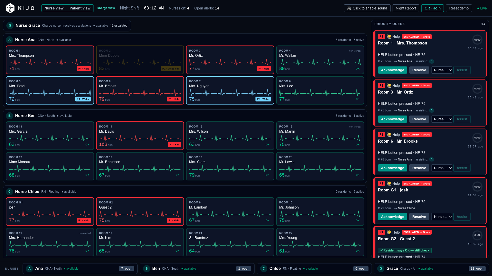
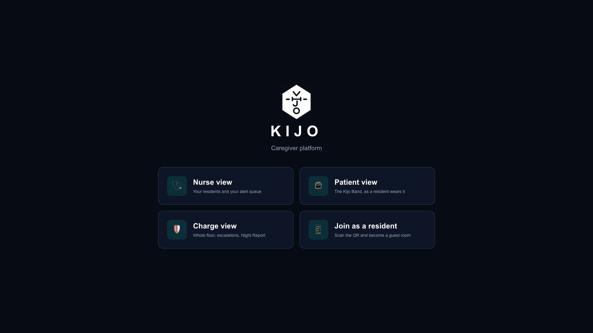
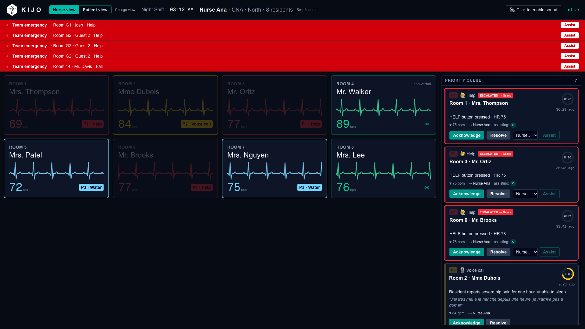
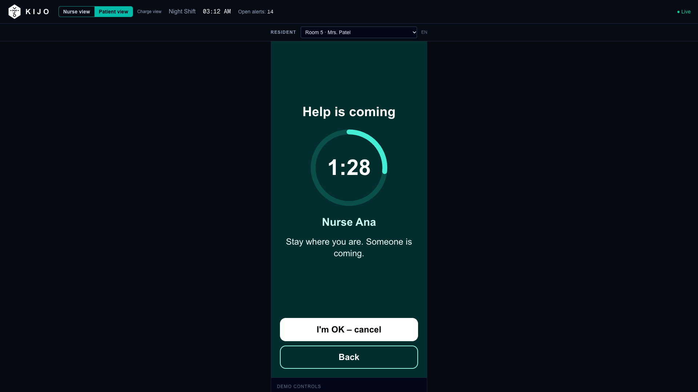
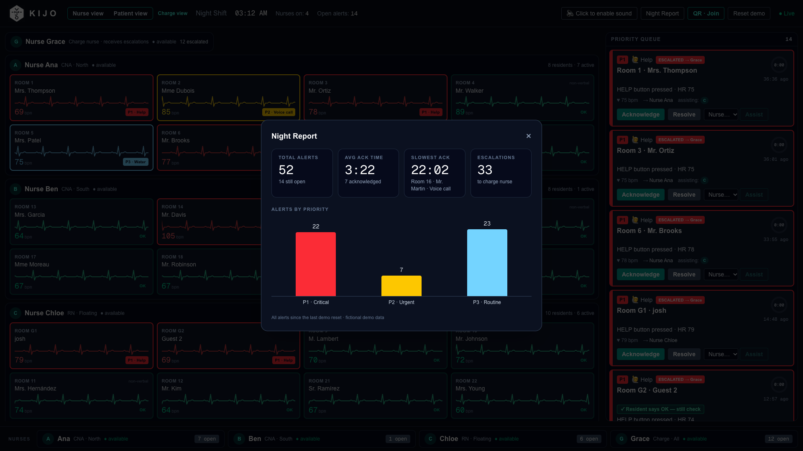

# Kijo — Caregiver platform

Kijo turns a resident's wristband (a phone stands in for it today) into a night-shift safety net: falls, help requests and spoken calls reach the right nurse in seconds, and escalate to the charge nurse if nobody answers.
Built for nursing homes, where one nurse may cover a whole wing at 3 AM.

**Live demo: https://kijo-band.vercel.app**



## The views

| View | Route | Who | What it shows |
|---|---|---|---|
| **Nurse view** | `/nurse` → `/nurse/[id]` | One nurse (Ana, Ben, Chloe) | Only *her* residents and *her* alert queue, with alarm sounds for her alerts. A red "Team emergency" strip appears when a colleague's resident has an open P1, with one-tap **Assist**. |
| **Patient view** | `/patient` | Resident (demo) | The Kijo Band app as the resident wears it: big help buttons, voice calls, fall detection, and a "Help is coming" countdown ring once an alert is sent. |
| **Charge view** | `/dashboard` | Charge nurse (Grace) | The whole floor: every pod, the full priority queue, escalations, Night Report, QR code, demo reset. |
| **Join as a resident** | `/join` (QR code) | Judges / audience | Scan the QR code on the big screen, become a guest room on your own phone, and press help — the alert lands on the dashboard live. |

`/` is a landing page with all four. Press **V** on any dashboard to switch between Nurse view and Patient view.

## How it works

```
 Resident band (phone PWA, /band)                      Nurse phones
 ├─ motion sensors → fall / no-movement / up-at-night     ▲  ntfy push with "I'm on it"
 ├─ big HELP + need buttons (water, bathroom, pain)       │  (acknowledges via /api/ack + per-alert token)
 └─ voice: trigger word heard → ONE sentence sent         │
          │                                               │
          ▼                                               │
 Next.js API routes on Vercel ─────────────────────────────┤
 ├─ /api/alert      rule-based priority (P1 / P2 / P3)    │
 ├─ /api/triage     Claude classifies the sentence ───────┘
 │                  (keyword fallback if Claude is slow or unsure)
 ├─ /api/heartbeat  heart rate + motion state
 └─ /api/escalate   no answer in 90 s → charge nurse (second push)
          │
          ▼
 Neon Postgres (residents · nurses · alerts)
          ▲
          │  polled every second (/api/state)
 Nurse view · Charge view · Patient view
 └─ Acknowledge / Resolve / Assist → resident status + nurse status update for everyone
```

Alarm colors follow the IEC 60601-1-8 convention: **P1 red** (fast flash), **P2 yellow** (slow flash), **P3 light blue** (steady), **OK green**.

## Tech stack

- **Next.js 16** (App Router, Partial Prerendering) · **React 19** · **TypeScript** · **Tailwind CSS v4**
- **Neon** serverless Postgres (parameterized SQL only)
- **Claude** (Anthropic API) for voice triage, server-side only, with a deterministic keyword fallback
- **ntfy** for push notifications to nurse phones
- Browser APIs: Web Speech (voice trigger), DeviceMotion (falls / activity), camera PPG (optional pulse spot check), Web Audio (alarm tones), PWA + service worker
- Hosted on **Vercel**

## Security & privacy

- **No audio is recorded, stored or uploaded by Kijo.** Speech is transcribed by the phone's built-in browser speech recognizer; Kijo only acts when a final sentence contains a trigger word, and sends **only that one sentence** (≤ 300 characters) to its server. *(Depending on the browser, the platform's own recognizer may use the vendor's speech service.)*
- **Fictional demo data.** Every resident, nurse and medical detail is made up. No real patient data is ever used.
- **Secrets stay server-side.** The Anthropic key, database URL, ntfy topic and admin secret live only in server environment variables; the production client bundle has been scanned to confirm none of them (names or values) ship to the browser. `.env*` is git-ignored; only an empty `.env.example` is committed.
- **Per-alert acknowledgement tokens.** The "I'm on it" button on a nurse's push carries a random 192-bit token unique to that alert, compared in constant time. Tokens and device ids are never returned by any API.
- **Rate limits.** Alerts: one per resident per 10 s. Cancel, heartbeat, dashboard actions and escalation are throttled; demo reset allows 5 attempts per minute and compares the admin secret in constant time.
- **Input validation everywhere.** Strict ids, numeric ranges and length caps on every API route; parameterized SQL only.
- **Prompt-injection guard.** The transcript is treated as data, Claude's JSON reply is validated, and anything unexpected falls back to keyword triage.
- **Security headers.** Content-Security-Policy (same-origin only), X-Frame-Options `SAMEORIGIN`, `nosniff`, Referrer-Policy, HSTS, and a Permissions-Policy that allows camera, microphone and motion sensors for this site only.
- **Known demo trade-off:** the dashboards have no login, so anyone with the URL can acknowledge or resolve demo alerts. A real deployment would put them behind staff SSO.

## Run it locally

Requirements: Node.js 20.9+, a free [Neon](https://neon.tech) Postgres database.

```bash
git clone https://github.com/JoJoshJo/kijo-band.git
cd kijo-band
npm install
cp .env.example .env.local   # then fill in the values below
npm run db:seed              # creates the tables and the fictional residents/nurses
npm run dev                  # http://localhost:3000
```

| Variable | Needed for |
|---|---|
| `DATABASE_URL` | Neon connection string (required) |
| `ANTHROPIC_API_KEY`, `ANTHROPIC_MODEL` | Claude voice triage (optional — keyword triage is used without it) |
| `NTFY_TOPIC` | Push notifications to nurse phones (optional; set `NTFY_DRY_RUN=1` to log instead of sending) |
| `NEXT_PUBLIC_APP_URL` | Public URL encoded in the QR code (defaults to the current site) |
| `DEMO_ADMIN_SECRET` | Demo reset from the Charge view |

`npm run db:seed` resets the demo data — don't run it against a database other people are using.

## Screenshots

| | |
|---|---|
|  |  |
|  |  |

---

Built at Clayton State Hack for Health 2026.
